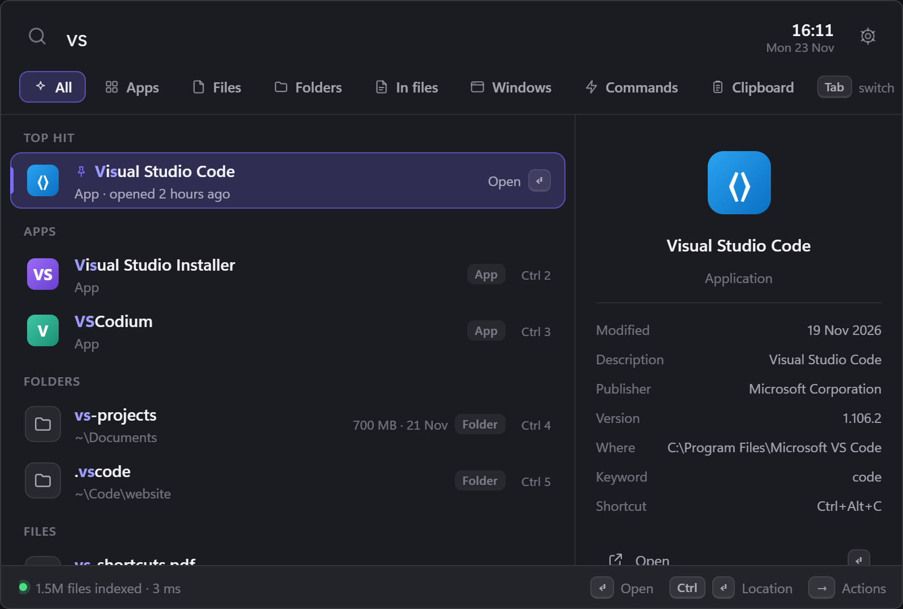
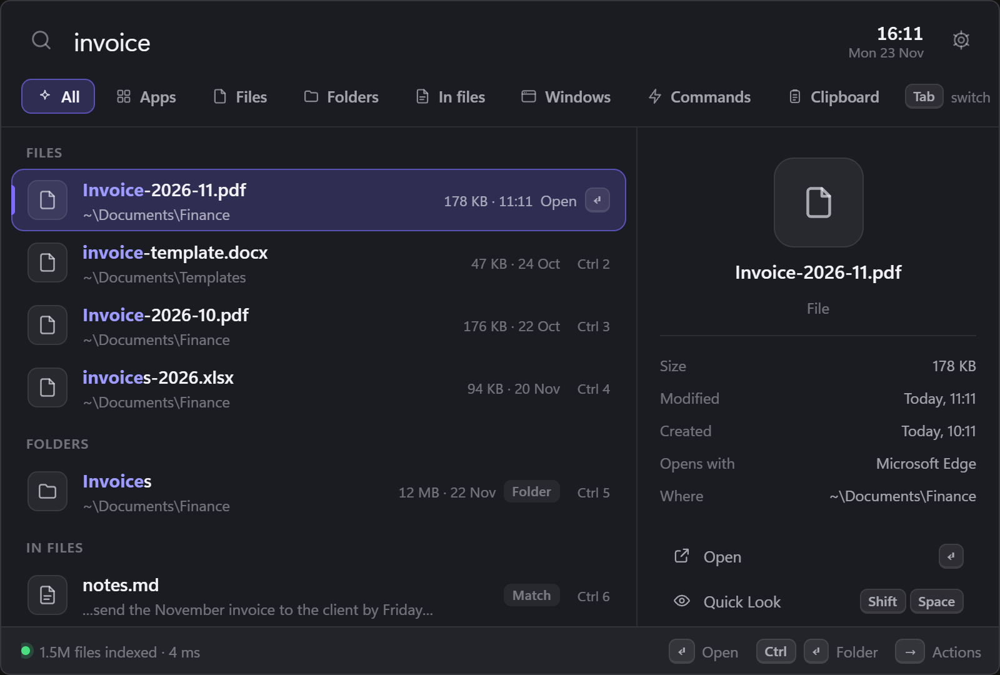
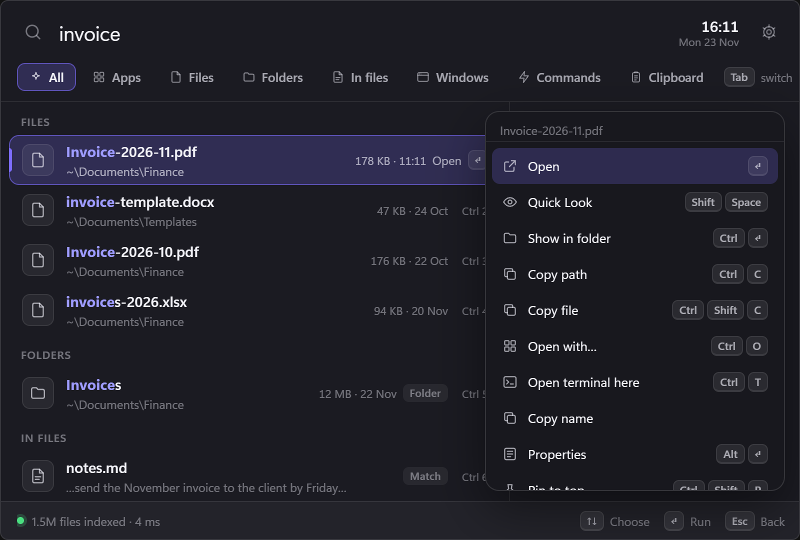
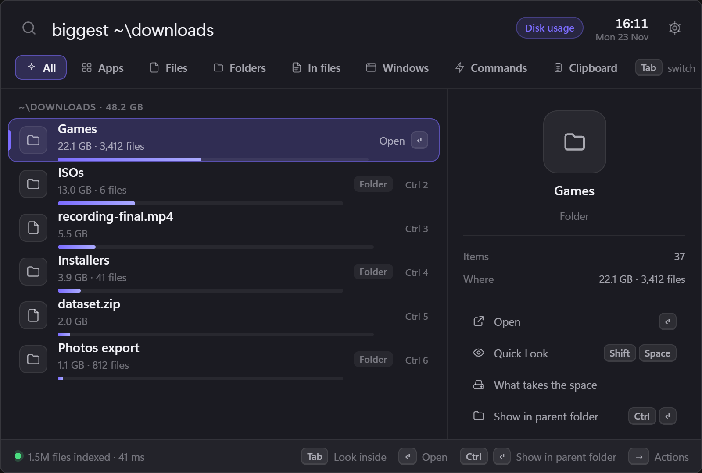
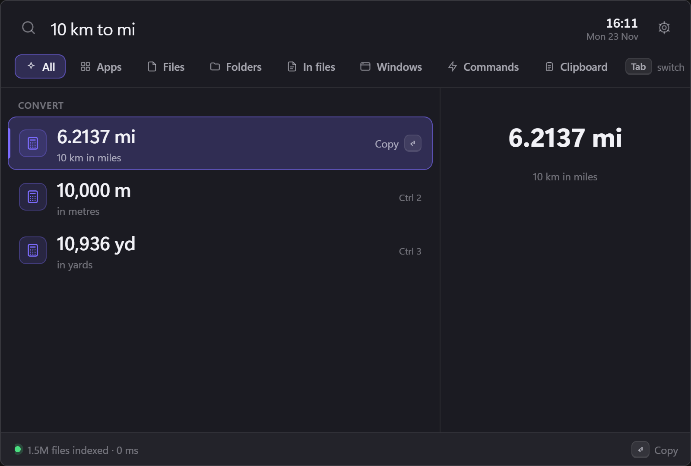

# Glint

A fast launcher and search for Windows, written in Rust. Tap the **Windows key** and type: apps,
every file and folder on your drives, the words inside your documents, open windows, Windows
settings, a calculator and more, all in one box.



## Why it's faster than Windows Search

- **Every file name is already in memory.** A small background service reads each NTFS drive's
  file table directly (the way Everything does) and follows the change journal, so new, renamed
  and deleted files show up within a second. Searching a million files takes a few milliseconds.
- **No web results, ads or news.** Nothing you type leaves your PC. A "search the web" row is
  offered at the bottom, and only opens your browser if you pick it.
- **It learns.** What you open ranks higher next time, and the item you chose after typing
  "ch" comes first the next time you type "ch".

## How it works

| | |
|---|---|
|  |  |
| **1. Type a few letters.** Files, folders and words inside documents come back in milliseconds, with size, date and a preview. | **2. Press → (or right-click) for actions.** Quick Look, show in folder, copy path, open with, terminal here, pin, global shortcut. |
|  |  |
| **3. Find what takes the space.** `biggest ~\Downloads` ranks folders and files by size; Tab looks inside. | **4. Calculate and convert.** Math, units, colors and quick toggles answer right in the box; Enter copies. |

## What it does

| Type | Gets you |
|---|---|
| `code`, `vsc` | Apps, by name, word start, initials or exe name |
| `budget 2024` | Files and folders on every fixed drive. Words can match parent folders too |
| `*.pdf`, `ext:docx,xlsx`, `folder:` | Filter by type or kind |
| words inside a document | File contents: text and code, Word, Excel, PowerPoint, OpenDocument, EPUB, PDF |
| a window title | Switch to an open window, or close it |
| `wifi`, `sound`, `lock`, `restart` | Windows Settings pages and system actions |
| `2^10/4`, `15% of 80`, `10 km to mi`, `255 to hex` | Calculator and unit converter |
| `#7c6cff`, `rgb(…)` | Color conversions |
| `C:\`, `~\Downloads`, `%appdata%` | Browse folders, with Tab to complete |
| `>ipconfig /all` | Run a command in PowerShell (Shift+Enter: as admin) |
| `kill chrome` | End a process |
| `?anything` | Web search with your chosen engine |
| `dm:today`, `dm:3d`, `size:>100mb`, `size:huge` | Filter files by date changed or size (recent files also rank higher) |
| `vol 40`, `mute`, `wifi off`, `bt on` | Quick toggles |
| `ip`, `battery`, `uptime`, `ram`, `disk` | System info; Enter copies |
| `left`, `max`, `center`, `third`, `next monitor` | Move the window you came from |
| `play`, `pause`, `next`, `prev` | Media controls, plus a "Now playing" card (can be turned off) |
| `clip invoice` | Search [ClipVault](https://github.com/JustSad42/ClipVault) clipboard history; Enter pastes |
| `timer 10m tea`, `remind 3pm call`, `remind in 20m stretch` | Timers and reminders with a corner notice (snooze 5/15 min) |
| `vol spotify 30`, `mute discord`, `audio headphones` | Per-app volume and switching the output device |
| `biggest`, `biggest ~\Downloads` | What takes the space (folder sizes from the index; Tab looks inside) |
| `tab youtube`, `bm recipes`, or just words | Open browser tabs (Enter switches to the tab), bookmarks and history from Chrome, Edge, Brave |
| `dl`, `ss`, `downloads` | Latest download · latest screenshot (Enter copies the image) |
| a script's name | Your own `.ps1/.bat/.py/.js` from the scripts folder, with arguments |

**Keys:** Enter opens · Ctrl+Enter shows in folder · Shift+Enter runs as admin · → or Ctrl+K for all
actions (copy path, copy file, open with, terminal here, VS Code, properties, recycle) · Tab switches
filter · Ctrl+1…9 opens a result · ↑ on an empty box recalls past searches · Ctrl+P toggles the
preview pane · Shift+Space opens Quick Look · Ctrl+Shift+P pins an item · → › Set a global shortcut opens anything from anywhere · → › Add keyword gives it a shortcut word.

The preview plays images, video and audio, and shows dimensions, length, the app a file opens
with, version info for programs, shortcut targets and what's inside zip archives.

Typos are forgiven ("spotfy", "dicord"). Glint can open on the screen with your mouse or always on the main screen, as a
pop-up or docked like the classic Start menu (pinned apps, All apps, folders, power), with the time and date in view.

**Win+E** can open [File Pilot](https://filepilot.tech) instead of File Explorer.

## How it's built

- `rust/core`: the file-name index (packed in-memory table, parallel ranked search), NTFS
  MFT/USN journal reader, and the named-pipe protocol.
- `rust/indexer`: `glint-indexer.exe`, a Windows service running as SYSTEM (reading a drive's file
  table needs admin rights). It answers searches over a local pipe that only the signed-in user,
  admins and SYSTEM may open.
- `rust/app`: `Glint.exe`, the Tauri 2 launcher, running as you. Apps come from the shell's
  AppsFolder, icons and thumbnails from the shell image factory, content search from a tantivy
  index kept up to date by a file watcher at background priority. A low-level keyboard hook
  turns a lone Windows-key tap into "open Glint" without breaking Win+ shortcuts.

## Build

Needs Rust and [Inno Setup 6](https://jrsoftware.org/isinfo.php).

```powershell
.\release.ps1            # tests, release build, installer in dist\
```

## Privacy

Everything stays on your PC. The only network requests are the daily update check against this
repo's GitHub releases (it can be turned off) and, when you press Enter on "Public IP", a
lookup at api.ipify.org. Content search never reads online-only OneDrive
files or files that typically hold secrets (`.env`, keys, password databases).

## License

MIT
